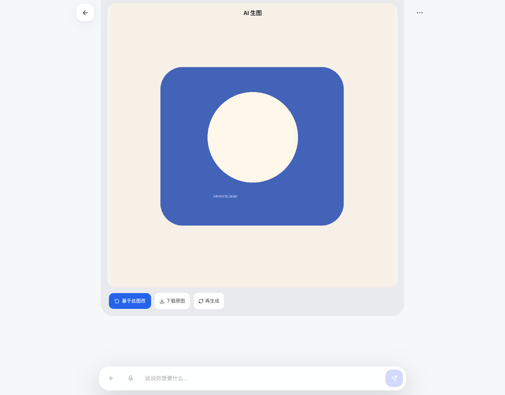
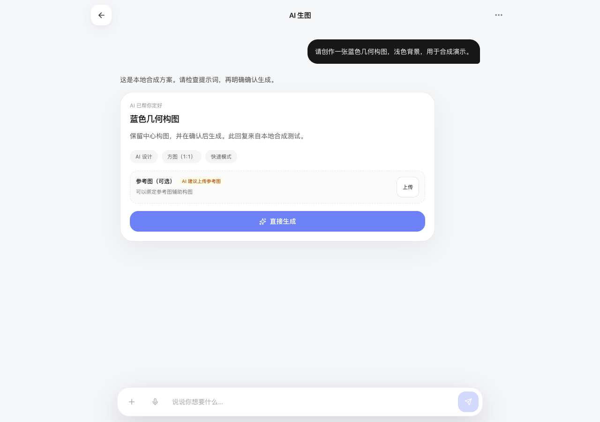
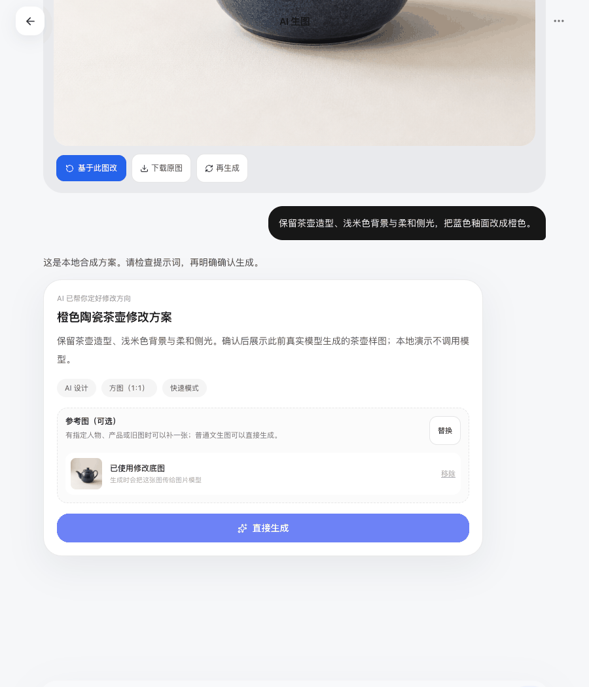
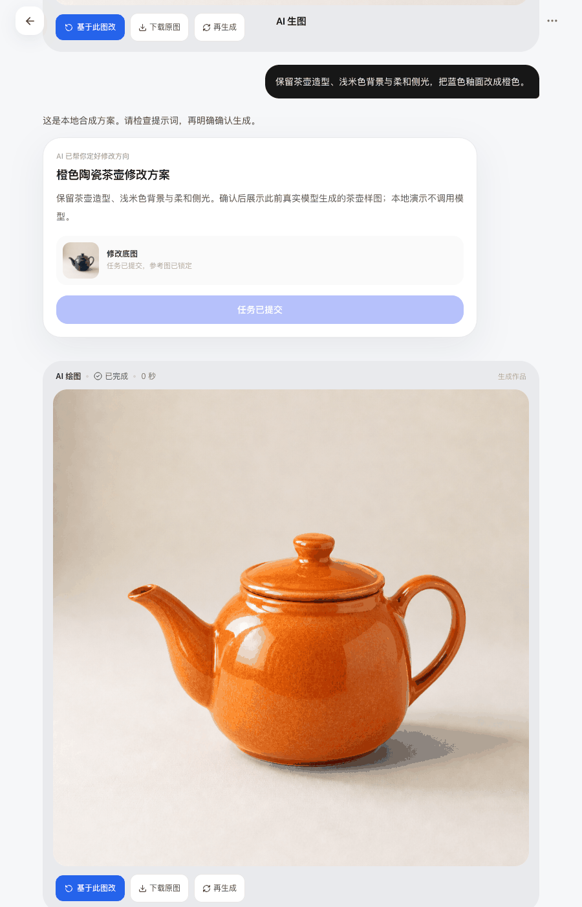

[简体中文](README.md) | [English](README.en.md)

# Media Workspace

A self-hosted AI image creation web app that generates after proposal confirmation.

<p align="center">
  
</p>

_The interfaces below come from a local synthetic demo. The blue and orange teapots are samples previously generated by a real model; no model was called for these screenshots._

## Local installation

Requires Python 3.10+, Node.js 20.19+ or 22.12+, and Linux/macOS (image job process locks use `fcntl`).

```bash
git clone https://github.com/bmdy6/media-workspace.git
cd media-workspace
python3 -m venv .venv
. .venv/bin/activate
pip install -e '.[test]'
npm --prefix frontend ci
npm --prefix frontend run build
```

Explicitly export the variables you need from [.env.example](.env.example) into the startup process. The application does not load `.env` automatically. Set at least:

```bash
export MEDIA_DATA_DIR="$PWD/data"
export SECRET_KEY="$(python3 -c 'import secrets; print(secrets.token_urlsafe(48))')"
export MEDIA_CHAT_BASE_URL="https://api.openai.com/v1"
export MEDIA_IMAGE_BASE_URL="https://api.openai.com/v1"
# Inject MEDIA_CHAT_API_KEY and MEDIA_IMAGE_API_KEY from your secure configuration; never commit them to Git.
python -m media.cli admin create admin
uvicorn media.web.backend.main:app --host 127.0.0.1 --port 8000 --workers 1
```

The administrator creation command hides password input. Open `http://127.0.0.1:8000` and sign in with that account. `SECRET_KEY` must contain at least 32 characters; generate it once and persist it for production instead of changing it on restart. New passwords must be at least 6 characters and at most 72 UTF-8 bytes. Use `python -m media.cli invite create` to create a single-use invitation code.

The default chat model is `gpt-6-luna` and the image model is `gpt-image-2`, using the official Chat Completions / Images APIs. Images default to 1:1 and low quality. Model access depends on your account. To change models or use OhMyGPT, configure the model, parameters, and protocol together according to the [configuration guide](docs/configuration.md); replacing the URL alone is insufficient.

## What it can do

Built with React + FastAPI + SQLite, with the complete frontend and backend included. It shares a creative focus with [image-mcp](https://github.com/bmdy6/image-mcp): this project provides a web interface, while image-mcp provides an Agent tool entry point. They run independently and do not share a deployed backend. This repository does not provide a hosted demo.

Discuss an idea to turn it into a proposal, attach reference images when needed, and generate only after explicit confirmation. Download and revisit results, then continue editing from the previous image.

- Streaming conversations and proposal cards distinguish discussion from image generation. No image request is submitted before confirmation.
- Upload reference images, attach them to proposal cards, and remove them; upload progress, cancellation, and retry after failure are retained.
- Persistent image jobs, idempotent requests, recovery after refresh, session history, and continued editing.
- Password login, invitation-code registration, JWT authentication, and isolation between users' data.
- Optional live voice input, recording pause/resume/cancel, and text cleanup that preserves the original transcript.

Uploading new reference images requires Tencent Cloud COS. The default local mode supports text-to-image and continued editing while the local original remains available. Originals are retained for 24 hours by default, so download them promptly. History does not mean originals are retained permanently. Enable COS transfer for long-term image storage; see [Configuration and deployment](docs/configuration.md).

### From proposal to result, then further edits

Review the proposal first, then explicitly confirm to submit the image job.



Download the result or click “Edit based on this image” to discuss another proposal.





## Try and develop without model calls

```bash
# Complete installation and the frontend build above first.
python scripts/synthetic_demo.py
```

Open `http://127.0.0.1:8765` and use `demo` / `synthetic-demo-password`. This entry point listens only on loopback, uses temporary SQLite, teapot samples previously generated by a real model, and an in-memory COS substitute. It blocks external HTTP requests and cleans up temporary data on exit. Local synthetic services drive conversations and jobs; images are read directly from `docs/assets/live-generated.png` and `live-edited.png`, without calling a model. It is for checking the workflow, not for starting production.

For frontend development, run `npm --prefix frontend run dev` in another terminal. Vite forwards `/api` to local port 8000 and the voice WebSocket to local port 18766. See [Voice documentation](docs/voice.md) for configuration and limitations.

## Verification

```bash
pytest -q
npm --prefix frontend test
npm --prefix frontend run build
```

Tests use synthetic data. Separate live acceptance has covered official proposal requests, low-quality text-to-image, continued editing from local image history, protected original-image downloads, and idempotent repeated confirmation. Real COS reference uploads and a real microphone/ASR have not yet been verified. See the [validation record](docs/validation.md) for evidence and limitations.

This project was extracted from an existing personal creative workspace. See [Provenance](docs/provenance.md) and [SOURCE_MANIFEST.json](SOURCE_MANIFEST.json) for the source revision, file hashes, and standalone boundaries. MIT License.
