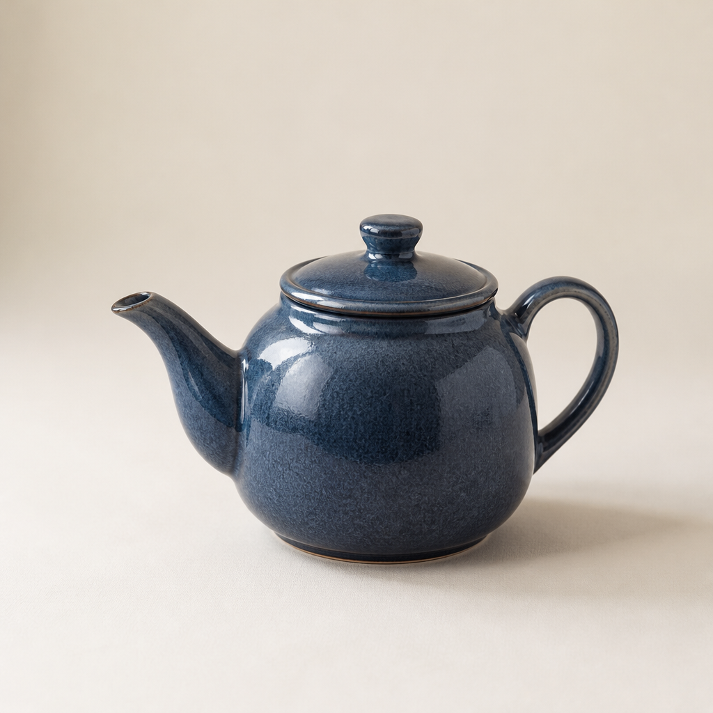

# 验证记录

2026-11-09 至 2026-11-10，针对独立导出的应用验证。所有凭据仅注入测试进程，测试使用独立临时数据；没有连接原个人工作台或私人 COS。

## 真实模型效果

先通过官方 `/v1/models` 确认账号可访问 `gpt-6-luna` 与 `gpt-image-2`，随后恰好发出 3 次模型 POST：

| 步骤 | 实际接口 | 结果 |
|---|---|---|
| 将想法形成可确认的方案卡 | `/v1/chat/completions` | 200，返回有效方案卡 |
| 确认蓝色陶瓷茶壶方案 | `/v1/images/generations` | 200，low，1024 × 1024 |
| 用本地已生成原图作为底图，改为橙色 | `/v1/images/edits` | 200，low，1024 × 1024 |

通过实际 FastAPI 登录、方案、托管任务、受保护结果下载及历史接口执行。两次重复确认分别返回原任务 ID，没有增加 provider 调用。历史中有两件作品。第二张通过归属于当前用户的 `parent_id` 读取本地原图，没有使用 COS。

脱敏请求计数、任务结果及尺寸见 [机器可读记录](live-validation.json)。

目视检查：茶壶由蓝色变为橙色，壶形、位置、米白桌面、背景和构图保持一致。这是本次样例的结果，不是对所有提示词的效果保证。没有追加模型重试，也没有第三张图片。

| 文生图 | 继续修改 |
|---|---|
|  |  |

## 合成回归与页面验收

合成测试覆盖登录/注册、邀请码并发消费与回滚、用户隔离、任务状态、重复提交、原图下载、失败恢复、参考图边界、两种图片 provider 协议、显式配置与语音生命周期。前端测试覆盖上传取消、参考图绑定、异步迟到响应、聊天及图片任务恢复、登录变更、语音和润色状态保护。

Ego 浏览器使用实际 React 页面与 FastAPI/SQLite，只有模型和 COS 被替换成合成实现，完成：登录 → 需求 → 方案 → 上传参考图 → 卡片绑定 → 刷新恢复 → 明确确认 → 第一张结果 → 下载目标读取 → 基于结果修改 → 第二张结果。方案与参考图绑定阶段图片 provider 调用为 0；两次确认后共 2 次图片调用，均携带参考字节。390px 视口无横向溢出，四处图像均完成加载。

最终默认本地模式额外完成：文生图 → 本地原图生成修改方案 → 刷新恢复已绑定底图 → 确认编辑。合成计数为 chat=2、image=2、with_reference=1、storage=0，第二张确实携带底图字节。浏览器原生下载事件成功并保存可解码 PNG。较早的合成 COS 链接只验证了下载目标读取，原生 download 事件未通过，不等同于真实 COS 验收。

将本地底图人为设为过期后，历史文字和另一张有效作品仍显示；尝试发送不会增加模型调用，明确点击“清除”后可继续新对话。后端另覆盖跨用户、过期和方案确认时更换 parent 的拒绝路径。

全新虚拟环境从 wheel 安装成功，在源码目录外验证配置/提示词资源、API 启停、未登录拒绝和 CLI 帮助；网页仍需按 README 从源码构建前端。

最终本地检查：后端 **196** 项、前端 **160** 项通过，前端构建通过。独立只读审查复核了身份、配置、来源边界和本地底图传输/过期恢复；相关后端 43 项、前端 49 项独立通过。npm 依赖审计在验证当日为 0 个已报告漏洞；这不是永久安全保证。

## 已知边界

- 真实新参考图上传/COS 转存没有实测；合成 COS 仅证明应用集成流程。
- 没有实测真实麦克风、ASR 模型文件或 Groq 转写；仅完成可选链路的合成回归。
- 没有部署公网服务、测试 MySQL 或多实例队列。默认支持 Linux/macOS 单进程。
- 本地模式原图默认保留 24 小时，历史记录不能保证过期后仍可编辑或下载。
- GitHub CI 结果以当前仓库检查为准；本记录不以本地通过代替远端 CI。
